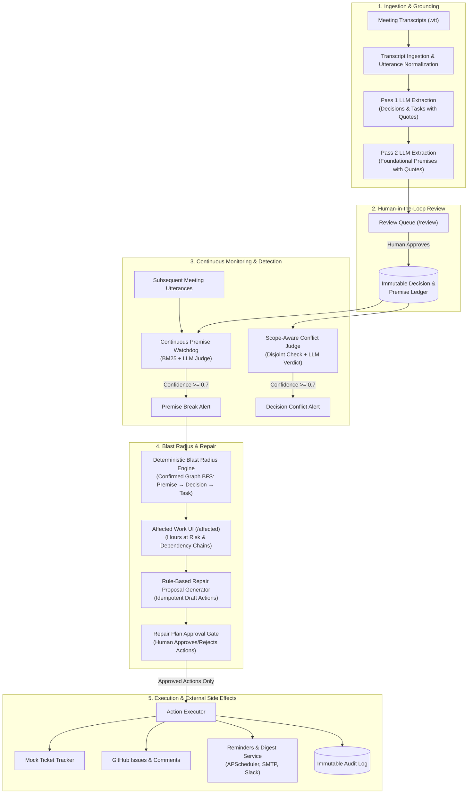

# Decidr (ChangeGuard)

> **Autonomous architectural governance and operational decision-tracking system that anchors engineering decisions to explicit premises, continuously monitors meetings for premise breaks, and generates blast-radius-aware repair plans with zero unapproved external writes.**

---

## What It Is

In fast-paced engineering organizations, architectural decisions are made based on implicit or explicit assumptions—such as a payment vendor's SLA, database transaction limits, or delivery deadlines. Over time, subsequent meetings undermine these assumptions, yet implementation tasks continue in Jira or GitHub for weeks before anyone realizes the foundation has broken.

**Decidr** solves this silent drift through continuous, quote-grounded governance:
1. **Two-Pass Extraction**: Verbatim quote-grounded extraction of Decisions, Action Items, and their explicit Foundational Premises.
2. **Review Queue**: Human reviewers approve extracted items before they enter the immutable ledger.
3. **Continuous Premise Watchdog**: Scans every utterance in future meetings against active premises to detect when assumptions break.
4. **Scope-Aware Conflict Detection**: Detects contradictions, supersessions, and duplicates across decisions with overlapping project/regional scopes.
5. **Deterministic Blast Radius BFS**: Traverses confirmed relational links (`premise` &rarr; `decision` &rarr; `depends_on` &rarr; `implements` &rarr; `task`) to calculate exact downstream impact, hours at risk, and unaffected items with formal mathematical explanations.
6. **Rule-Based Repair Plans & Human Approval Gate**: Generates idempotent change proposals (comment on ticket, pause reminders, reopen task, mark at-risk) requiring explicit human sign-off before executing writes to GitHub or mock trackers.
7. **Zero Unapproved External Writes**: Strict architectural invariant ensuring no external tracker or notification side effect occurs without an approved change action record.
8. **Multi-Channel Reminders & Weekly Digest**: Scheduled delivery with cadence warnings when tasks rest on shaky or broken premises.

---

## Architecture



---

## Quickstart Setup (Under 10 Commands)

```bash
# 1. Clone repository
git clone https://github.com/rpravin-02/Decidr.git decidr && cd decidr

# 2. Set up Python virtual environment
python -m venv .venv && .\.venv\Scripts\activate

# 3. Install backend dependencies
pip install -r backend/requirements.txt

# 4. Install frontend dependencies
npm --prefix frontend install

# 5. Configure environment variables
cp .env.example .env

# 6. Initialize database
python scripts/reset_db.py

# 7. Seed demo state (M1 approved, M2 ready to process)
python scripts/demo_reset.py

# 8. Run backend API server
uvicorn backend.app.main:app --reload --port 8000

# 9. In a separate terminal, run frontend dashboard
npm --prefix frontend run dev
```

Open `http://localhost:3000` in your browser.

---

## Environment Variables

| Variable | Default | Description |
| :--- | :--- | :--- |
| `DATABASE_URL` | `sqlite:///./decidr.db` | SQLAlchemy database connection string (SQLite or PostgreSQL) |
| `LLM_PROVIDER` | `gemini` | LLM provider backend (`gemini` or `anthropic`) |
| `LLM_MODE` | `cache` | Mode for LLM adapter: `live`, `cache`, or `replay` |
| `LLM_MODEL` | `gemini-1.5-pro` | Model name for extraction and evaluation |
| `GEMINI_API_KEY` | `""` | Google Gemini API key (required if `LLM_MODE=live`) |
| `ANTHROPIC_API_KEY` | `""` | Anthropic Claude API key (optional alternative) |
| `TRACKER` | `mock` | Issue tracker integration (`mock` or `github`) |
| `GITHUB_TOKEN` | `""` | GitHub Personal Access Token for issue tracking |
| `GITHUB_REPO` | `""` | Target repository formatted as `owner/repo` |
| `SMTP_HOST` | `localhost` | Outbox SMTP server host |
| `SMTP_PORT` | `587` | Outbox SMTP server port |
| `SMTP_USER` | `""` | Outbox SMTP username |
| `SMTP_PASSWORD` | `""` | Outbox SMTP password |
| `SMTP_FROM` | `decidr@example.com` | Default sender email for reminders and digests |
| `SLACK_WEBHOOK_URL` | `""` | Incoming Slack webhook URL for alerts and reminders |
| `TIMEZONE` | `UTC` | Timezone for reminder calculations |
| `DEMO_MODE` | `true` | Enables deterministic seeds, mock time, and replay adapters |
| `NEXT_PUBLIC_API_URL` | `http://localhost:8000` | Backend API URL for Next.js frontend |

---

## Running the Demo

For an end-to-end 3-minute demonstration:

```bash
# Reset database to initial demo state
make demo-reset
```

1. Navigate to `http://localhost:3000/`.
2. Locate **Meeting 2: "Vendor SLA & European Launch Review"** and click **Process**.
3. With `LLM_MODE=replay`, the meeting processes instantly offline.
4. Click **Review Queue** to inspect the detected **Premise Break Alert** (Vendor SLA changes from T+0 to T+2).
5. Click **Confirm Break** to transition the premise to `broken`.
6. Open **Affected Work** (`/affected`) to view the downstream dependency graph and `64.0` hours at risk.
7. Click **Review Repair Plan** and **Approve Actions** to pause reminders and update tracker tickets.
8. View updated status across `/my-week`, `/ledger`, and `/audit`.

See [`docs/DEMO.md`](file:///c:/Users/rprav/OneDrive/Desktop/Decidr/docs/DEMO.md) for the verbatim presenter script, timing markers, and offline fallback procedures. A pre-recorded backup video is available at [`docs/backup-demo.webm`](file:///c:/Users/rprav/OneDrive/Desktop/Decidr/docs/backup-demo.webm).

---

## Running Tests

Run the complete backend test suite:

```bash
make test
# Or directly:
.\.venv\Scripts\pytest backend/tests
```

Run frontend production build verification:

```bash
npm --prefix frontend run build
```

---

## Running Evaluations

Decidr includes a rigorous evaluation harness benchmarked against gold-standard labels across meetings M1–M4 and held-out meetings H1–H2. Metrics are computed dynamically, never hardcoded.

```bash
# Evaluate pipeline on Development set (M1–M4)
python backend/eval/run_eval.py

# Evaluate on Held-out set (H1–H2)
python backend/eval/run_eval.py --heldout
```

Evaluated dimensions include:
- **Extraction Recall & Precision**: Decisions, tasks, and foundational premises.
- **Premise Break Detection**: Precision and recall against gold premise breaks.
- **Conflict Detection**: Precision and recall against gold decision contradictions and supersessions.
- **Blast Radius Impact Precision & Recall**: Accuracy of downstream affected tasks.
- **Repair Plan Correctness**: Target and action type alignment against gold repair proposals.
- **Writes Without Approval (Target: 0)**: Invariant verification that zero external tracker writes occurred without prior human approval.

---

## Data Privacy & Retention

Decidr is designed with strict privacy controls for confidential leadership and engineering discussions:
- **Local SQLite / Self-Hosted DB**: Audio transcripts and derived items remain within your infrastructure.
- **Minimal LLM Transmission Boundary**: Only anonymized utterance snippets and premise texts are sent to the LLM judge during watchdog verification.
- **Immutable Privacy Purge**: `DELETE /meetings/{id}` permanently purges meeting transcripts, utterances, and derived items while preserving a non-content audit record (`retained_content: "none"`).

See [`docs/PRIVACY.md`](file:///c:/Users/rprav/OneDrive/Desktop/Decidr/docs/PRIVACY.md) for full compliance specifications.

---

## License

MIT
